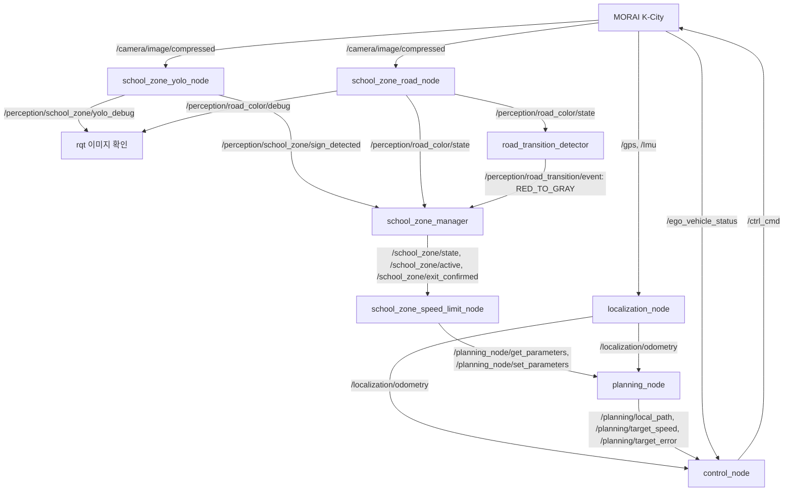

# MORAI 기반 어린이보호구역 인식 및 자동 속도 제어

## 1. 프로젝트 개요

EdgeNode는 MORAI K-City 시뮬레이션에서 카메라로 어린이보호구역 표지판과 노면을 인식하고, 차량의 경로 계획 및 제어와 연결하는 ROS 2 시스템이다. 표지판 진입 이벤트를 받으면 속도 상한을 30km/h로 낮추고, 종료 확인 후 진입 전 상한으로 복구하는 것을 목표로 한다.

표지판은 구역 진입의 단서이고 빨간 노면은 진입 이후의 구역 관측 정보다. 빨간색에서 회색으로의 전환은 **종료 후보**이며 실제 도로의 법적 어린이보호구역 종료를 확정하는 근거가 아니다. 자동 종료 확인과 주행 중 속도 복구는 명시적으로 활성화하는 MORAI 시뮬레이션용 기능이다.

이 문서는 `perception` 브랜치의 소스 및 조회 가능한 컨테이너 환경을 기준으로 한다. 구현 사실과 실제 주행 검증 결과를 구분하며, 인식 정확도나 주행 성공률을 보장하지 않는다.

## 2. 개발 환경

| 항목 | 확인한 구성 | 확인 범위 |
|---|---|---|
| OS | Ubuntu 22.04.5 LTS, Python 3.10.12 | 현재 컨테이너의 `/etc/os-release`, Python 조회 결과. 호스트 OS는 별도 확인 필요 |
| ROS 2 | Humble | `Dockerfile`의 `ros:humble-ros-base-jammy`, `/opt/ros/humble` |
| 시뮬레이터 | MORAI K-City | K-City MGeo 및 MORAI 메시지 연동 코드. 시뮬레이터 버전은 미확인 |
| 객체 탐지 | YOLO26 Nano용 사용자 학습 가중치 사용 전제 | `best.pt`를 Ultralytics로 로드. 소스만으로 가중치의 모델 구조·학습 이력을 확정할 수 없어 메타데이터 검증 필요 |
| Ultralytics | 8.4.208 | 기존 `local_data/yolo_venv` 패키지 메타데이터 |
| PyTorch | 2.9.1+cu128 | 동일 가상환경. CUDA 12.8 빌드 표기이며 호스트 CUDA Toolkit 설치 버전을 뜻하지 않음 |
| OpenCV / NumPy | 4.11.0.86 / 1.26.4 | 동일 가상환경. 일반 ROS Python 환경과 버전이 다를 수 있음 |
| GPU | NVIDIA GeForce RTX 4050 Laptop GPU | `nvidia-smi` 조회, 드라이버 580.178.04. 추론 성능 측정은 별도 필요 |
| 컨테이너 | Compose `autonomous` 서비스, Dev Container 사용자 `dev` | 호스트 네트워크·IPC, `gpus: all`, 프로젝트를 `/workspace`에 마운트 |

Compose의 기본 통신 설정은 `ROS_DOMAIN_ID=0`, `ROS_LOCALHOST_ONLY=0`, `RMW_IMPLEMENTATION=rmw_fastrtps_cpp`이다. 호스트 GUI 도구도 실제 컨테이너와 같은 Domain 및 호환 DDS 환경을 사용해야 한다.

가중치 기본 경로는 `/workspace/local_data/models/school_zone/best.pt`, YOLO Python 환경은 `/workspace/local_data/yolo_venv`이다. 둘 다 Git 배포 대상이 아니므로 새 환경에서는 별도 준비해야 한다. `Dockerfile`만으로 YOLO/PyTorch 및 GUI 도구가 모두 설치되지는 않는다.

## 3. 전체 시스템 아키텍처



Localization은 GPS·IMU로 위치와 자세를 추정한다. Planning은 MGeo 지도 매칭, Dijkstra 전역 경로, 국소 경로와 곡률 기반 권고 속도를 계산한다. 속도 제한 노드는 Planning의 상한 파라미터만 조정한다. Control은 국소 경로를 따라 Pure Pursuit로 조향하고 PID로 목표 속도를 추종해 MORAI 명령을 발행한다. 인식 노드가 직접 가속·제동 명령을 발행하지 않는다.

## 4. YOLO 기반 표지판 인식

운용 대상은 `school_zone_yolo_node.py`이다. `school_zone` 단일 클래스 YOLO26 Nano 학습 모델을 전제로 `best.pt`를 읽는다. **현재 코드는 `boxes.cls`나 클래스 이름을 검사하지 않고 모든 탐지 박스를 사용한다.** 다른 클래스가 포함된 가중치를 넣으면 그 탐지도 진입 조건에 포함되므로 배포 전 모델 클래스와 구조를 확인해야 한다.

| 항목 | 실제 구현 |
|---|---|
| 카메라 입력 | `CompressedImage`를 `cv2.imdecode`로 BGR 복원. 복원 실패 프레임은 이력에 넣지 않음 |
| 기본 탐지 조건 | `model.predict(conf=0.5, imgsz=640, device=...)` |
| 프레임 이력 | `deque(maxlen=5)`에 추론 프레임별 최대 Confidence 저장. 박스가 없으면 0 저장 |
| 진입 이벤트 | 이력이 5개이고, Confidence ≥ 0.50인 프레임이 3개 이상이며 최대 Confidence ≥ 0.80 |
| 중복 방지 | 조건 충족 시 `Bool(True)`를 1회 발행. 연속 10개 추론 프레임에서 미탐지하면 이력과 발행 잠금을 초기화 |
| 추론 주기 | `time.monotonic()`으로 시작 간격 0.2초 미만의 콜백을 생략하므로 최대 5FPS. 실측 5FPS 보장 아님 |
| 시각화 | `result.plot()` 결과를 `bgr8` 이미지로 발행. 입력 헤더 유지 |
| 설정 | `model_path` 기본값은 위 가중치 경로, `device` 기본값은 문자열 `0`. CPU 실행은 `device:=cpu` |

여기서 5프레임은 전체 카메라 수신 프레임이 아니라 **디코딩 및 추론을 수행한 프레임**이다. 카메라 속도, GPU 지연, 가려짐에 따라 이벤트 지연과 재탐지 시간은 달라진다.

[보관 스크립트 실행 안내](../../tools/school_zone_yolo/README.md)의 `school_zone_yolo_test.py`는 시각화용이며, `school_zone_yolo_bridge.py`는 2FPS·3/5 조건의 원본 보관본으로 0.80 조건이 없다. 새 노드와 보관본을 동시에 실행하면 동일 토픽의 발행자가 중복된다. 요청한 조건은 새 노드를 기준으로 한다.

## 5. 노면 색상 및 전환 인식

### 5.1 색상 분류

`school_zone_road_node`는 이미지 가로 30~70%, 세로 46~60% 영역을 ROI로 사용하고 BGR을 HSV로 변환한다. OpenCV Hue 범위는 0~179이다.

| 분류 | HSV 마스크 범위 및 판정 |
|---|---|
| 빨간색 | `(0,70,35)~(18,255,255)`와 `(170,70,35)~(179,255,255)`의 합집합. ROI 내 비율 ≥ 0.25이면 `RED` |
| 회색 | `(0,0,45)~(179,55,240)`. 빨간색 비율 ≤ 0.02이고 회색 비율 ≥ 0.35이면 `GRAY` |
| 불확실 | 나머지는 `UNKNOWN` |

최근 7프레임이 모두 채워진 뒤 그중 최소 5개가 같은 유효 색상이면 해당 색상을 발행하고, 그렇지 않으면 `UNKNOWN`을 발행한다. ROI·HSV·비율·프레임 수는 현재 코드 상수이며 ROS 파라미터가 아니다. `camera_topic`만 기본 카메라 토픽에서 변경할 수 있다. 빨간색 비율은 매 처리 프레임, ROI 디버그 이미지는 매 5번째 처리 프레임에 발행한다. 회색 비율 전용 출력 토픽은 없다.

### 5.2 빨간색 → 회색 전환

`road_transition_detector`는 영상이 아닌 안정화된 색상 문자열을 입력받는다.

| 파라미터 | 기본값 | 역할 |
|---|---:|---|
| `red_confirm_messages` | 3 | 연속 RED 메시지 3개로 전환 감지를 준비 |
| `gray_confirm_sec` | 1.5 | 준비 이후 연속 GRAY 수신 구간이 단조 시계 기준 1.5초 이상이면 `RED_TO_GRAY` 1회 발행 |
| `max_message_gap_sec` | 0.7 | 수신 공백 초과 시 빨간색 연속 횟수와 회색 유지 시간을 초기화 |
| `color_topic` | `/perception/road_color/state` | 색상 입력 |

`UNKNOWN`은 회색 유지 시간을 끊는다. 수신 공백이나 UNKNOWN은 이미 준비된 `armed` 상태 자체를 해제하지 않으며, 전환 이벤트 발행 시 해제된다. 전환 감지기의 `EXIT_CANDIDATE`는 관측 상태다. 구역 진입 표지판 이후인지 판정하는 역할은 Manager가 맡는다.

## 6. 어린이보호구역 상태 관리

`school_zone_manager`는 상태 전환 시와 1초 주기로 상태·활성 여부를 발행한다.

| 상태 | 의미 및 전환 조건 | active |
|---|---|---|
| `NORMAL` | 초기 상태 또는 테스트 reset. True 표지판 이벤트를 받으면 빨간색 대기로 전환 | false |
| `SCHOOL_ZONE_WAITING_FOR_RED` | 표지판 진입 이벤트 수신. 이후 RED를 받으면 빨간 노면 확인 상태로 전환 | true |
| `SCHOOL_ZONE_RED_CONFIRMED` | 표지판 이후 RED 관측. `RED_TO_GRAY`를 받으면 종료 후보로 전환 | true |
| `EXIT_CANDIDATE` | 종료 후보. RED가 다시 들어오면 빨간 노면 확인 상태로 복귀 | true |
| `EXIT_CONFIRMED` | 후보 상태에서 수동 확인 서비스 또는 시뮬레이션 자동 확인 완료. 새 True 표지판 이벤트로 재진입 가능 | false |

구역 활성 상태의 반복 표지판 이벤트와 False 이벤트는 진입 상태를 다시 만들지 않는다. 진입 전 노면 전환 이벤트도 종료 후보가 되지 않는다.

- `/school_zone_manager/confirm_exit` (`std_srvs/srv/Trigger`): 표지판 이후 RED를 보았고 현재 종료 후보인 경우만 수동 확인을 허용한다.
- `sim_auto_confirm_on_gray` 기본값은 `false`. `true`이면 후보 전환 약 0.5초 뒤에도 후보 상태일 때 시뮬레이션 종료를 자동 확인한다.
- `/school_zone_manager/reset` (`std_srvs/srv/Trigger`): 테스트 초기화이며 종료 확인이나 속도 복구의 근거가 아니다.

`/school_zone/exit_candidate`는 후보일 때만, `/school_zone/exit_confirmed`는 확인 상태일 때만 True다. 색상 변화만으로 실제 도로 경계를 판단하려면 지도·종료 표지판 등의 별도 근거가 필요하다.

## 7. 속도 제한과 복구

### 7.1 일반 구간 및 진입

현재 `config/planning.yaml`은 `cruise_speed_kmh=50.0`, `max_drive_speed_kmh=50.0`, `curve_speed_kmh=25.0`, `sharp_curve_speed_kmh=3.5`이다. 이는 **설정 속도**이며 실측 주행 속도가 아니다. Planning을 YAML 없이 실행하면 코드의 선언 기본값이 적용되므로 아래 실행 예제처럼 설정 파일을 전달해야 한다.

정상 주행 조건을 만족할 때 Planning 목표 속도는 권고 속도와 상한 중 작은 값이다. `enable_drive=false`, 경로·지도 매칭 문제, 주행 세션 만료 등의 조건에서는 정지 목표를 사용한다. 기본 주행 허용은 false이고 설정상 세션 길이는 60초다.

`school_zone_speed_limit_node`는 0.5초 타이머로 Planning 파라미터 서비스를 조회한다. 구역이 활성이고 현재 상한이 `school_zone_cap_kmh`(기본 30.0)보다 높으면 상한을 30으로 낮춘다. 이미 더 낮은 상한은 올리지 않는다. 실제 속도가 즉시 30이 되는 것은 아니며 감속 응답과 제동 거리는 통합 검증 대상이다.

### 7.2 종료 확인 후 복구 조건

진입 전 `NORMAL` 및 `active=false`에서 읽은 상한을 `baseline_cap`으로 보관한다. 복구는 이전 순간의 실측 속도가 아니라 이 **상한 파라미터**의 복구다. 다음 조건을 모두 확인한다.

1. `allow_confirmed_restore=true`이고 이번 구역에서 아직 복구하지 않았음.
2. 이 노드가 구역 활성화, 빨간 노면 확인, 종료 후보를 순서대로 관측했음.
3. 이 노드가 이번 구역에서 실제로 상한을 낮춘 이력이 있음.
4. `state=EXIT_CONFIRMED`, `exit_confirmed=true`, `active=false`임.
5. 보관된 정상 구간 상한이 존재하고 30km/h보다 높음.
6. 현재 상한이 여전히 구역 상한과 같음. 다른 주체가 낮춘 값을 덮어쓰지 않음.
7. 기본적으로 `enable_drive=false`여야 함. 이 값은 실제 정지 속도를 측정한 결과는 아니므로 실제 정지도 별도로 확인해야 함.

MORAI에서 주행 중 복구하려면 `sim_allow_moving_restore=true`도 필요하다. 이때 보관 상한이 `max_sim_restore_kmh`(기본 60.0)를 넘으면 복구하지 않는다. `allow_confirmed_restore`, `sim_allow_moving_restore`는 모두 기본 false다. 구역 중간에 노드를 시작하여 정상 상한을 관측하지 못했거나, 상태 메시지를 놓쳐 전 과정을 확인하지 못하면 복구가 차단될 수 있다.

Control은 기본 30Hz에서 실제 차량 상태와 목표 속도를 이용해 PID 가감속 및 Pure Pursuit 조향을 계산한다. 실제 속도 기반 lookahead와 입력 timeout 시 정지 처리가 있다. 상한 복구 후에도 곡률 권고 속도 및 주행 허용 조건은 계속 적용된다.

## 8. ROS 2 노드와 주요 인터페이스

아래는 기본 토픽 이름이다. 표의 타입은 ROS 2의 `패키지/msg/타입` 표기를 따른다. 속도 제한 노드의 Planning 연결은 토픽이 아닌 서비스다.

| 노드 | 입력 토픽·타입 | 출력 토픽·타입 | 주요 기능 |
|---|---|---|---|
| `school_zone_yolo_node` | `/camera/image/compressed` — `sensor_msgs/msg/CompressedImage` | `/perception/school_zone/sign_detected` — `std_msgs/msg/Bool`; `/perception/school_zone/yolo_debug` — `sensor_msgs/msg/Image` | 표지판 추론, 시간 조건, 진입 이벤트·박스 영상 |
| `school_zone_road_node` | `/camera/image/compressed` — `sensor_msgs/msg/CompressedImage` | `/perception/road_color/state` — `std_msgs/msg/String`; `/perception/road_color/red_ratio` — `std_msgs/msg/Float32`; `/perception/road_color/debug` — `sensor_msgs/msg/Image` | ROI HSV 색상 분류 및 프레임 안정화 |
| `road_transition_detector` | `/perception/road_color/state` — `std_msgs/msg/String` | `/perception/road_transition/state`, `/perception/road_transition/event` — `std_msgs/msg/String` | 연속 RED 및 지속 GRAY로 전환 후보 검출 |
| `school_zone_manager` | `/perception/school_zone/sign_detected` — `std_msgs/msg/Bool`; `/perception/road_color/state`, `/perception/road_transition/event` — `std_msgs/msg/String` | `/school_zone/state` — `std_msgs/msg/String`; `/school_zone/active`, `/school_zone/exit_candidate`, `/school_zone/exit_confirmed` — `std_msgs/msg/Bool` | 구역 진입·빨간 노면·종료 후보·확인 상태 관리 |
| `school_zone_speed_limit_node` | `/school_zone/state` — `std_msgs/msg/String`; `/school_zone/active`, `/school_zone/exit_confirmed` — `std_msgs/msg/Bool` | 직접 출력 토픽 없음 | `/planning_node/get_parameters` (`rcl_interfaces/srv/GetParameters`), `/planning_node/set_parameters` (`rcl_interfaces/srv/SetParameters`)로 속도 상한 관리 |
| `localization_node` | `/gps` — `morai_ros2_msgs/msg/GPSMessage`; `/Imu` — `sensor_msgs/msg/Imu` | `/localization/odometry`, `/localization/gps_odometry` — `nav_msgs/msg/Odometry`; `/localization/gps_speed` — `std_msgs/msg/Float32`; `/localization/status` — `std_msgs/msg/String` | GPS 좌표 변환, GPS·IMU EKF, 위치·자세·속도 추정 |
| `planning_node` | `/localization/odometry` — `nav_msgs/msg/Odometry` | `/planning/global_path`, `/planning/local_path` — `nav_msgs/msg/Path`; `/planning/target_error`, `/planning/target_speed`, `/planning/recommended_speed` — `std_msgs/msg/Float32`; `/planning/state`, `/planning/drive_status`, `/planning/current_link`, `/planning/map_match_status`, `/planning/speed_mode` — `std_msgs/msg/String` | 지도 매칭, 전역·국소 경로, 곡률 속도 계획 및 주행 허용 |
| `control_node` | `/planning/target_error`, `/planning/target_speed` — `std_msgs/msg/Float32`; `/planning/local_path` — `nav_msgs/msg/Path`; `/localization/odometry` — `nav_msgs/msg/Odometry`; `/ego_vehicle_status` — `morai_ros2_msgs/msg/EgoVehicleStatus` | `/ctrl_cmd` — `morai_ros2_msgs/msg/CtrlCmd`; `/control/path_error`, `/control/target_left`, `/control/target_forward`, `/control/pure_pursuit_steering`, `/control/lookahead_distance` — `std_msgs/msg/Float32` | 경로 추종, 실제 속도 피드백 및 가감속·조향 명령 |
| `route_editor_node` (선택) | `/clicked_point` — `geometry_msgs/msg/PointStamped`; `/planning/current_link` — `std_msgs/msg/String`; `/localization/odometry` — `nav_msgs/msg/Odometry` | `/route_editor/preview_path` — `nav_msgs/msg/Path`; `/route_editor/status` — `std_msgs/msg/String`; `/route_editor/mgeo_links`, `/route_editor/mgeo_nodes`, `/route_editor/waypoint_markers` — `visualization_msgs/msg/MarkerArray`; `/route_editor/vehicle_marker` — `visualization_msgs/msg/Marker` | RViz 경유점 편집 및 정지 상태의 경로 적용 |

Planning에는 추가 진단 출력으로 `/planning/local_path_index` (`std_msgs/msg/Int32`), `/planning/local_path_progress_m` (`std_msgs/msg/Float64`), `/planning/map_match_distance`, `/planning/map_match_heading_diff`, `/planning/speed_curvature`, `/planning/speed_max_curvature` (`std_msgs/msg/Float32`)가 있다. 카메라 구독과 디버그 영상 발행은 sensor-data QoS를 사용하므로 뷰어의 Reliability를 Best Effort에 맞춘다.

## 9. 전체 실행 방법

아래는 소스에 등록된 실행 항목과 설정 파일을 근거로 한 실행 절차다. 이 문서 작성 과정에서 차량을 주행시키거나 빌드·설치를 변경하지 않았다. 각 장기 실행 명령은 별도 터미널에서 수행하며 기존 동일 노드가 있으면 중복 실행하지 않는다.

### 9.1 Ubuntu 호스트: MORAI 및 Dev Container 준비

호스트에서 기존 MORAI 실행 방식으로 K-City와 사용 차량을 준비한다. 저장소에는 MORAI 바이너리 위치나 실행 스크립트가 없으므로 실행 명령을 제시하지 않는다. 센서·네트워크 설정에서 카메라, `/gps`, `/Imu`, `/ego_vehicle_status` 송신 및 `/ctrl_cmd` 수신을 확인한다. 실제 GUI 설정과 연결 성공은 현장에서 검증해야 한다.

VS Code의 기존 Dev Container 설정으로 프로젝트를 연다. `.devcontainer/devcontainer.json`은 Compose의 `autonomous` 서비스와 `/workspace`를 사용한다. GUI 도구는 현재 컨테이너에 설치되어 있지 않으므로 아래 별도 호스트 절차를 따른다.

### 9.2 Dev Container: 각 ROS 터미널의 환경 설정

```bash
cd /workspace/ros2_ws
source /opt/ros/humble/setup.bash
source /workspace/ros2_ws/install/setup.bash
```

`install/setup.bash`는 사전 빌드된 workspace가 있어야 한다. 새 체크아웃에서는 기존 프로젝트 빌드 절차인 `colcon build --symlink-install`을 먼저 수행한 후 source한다. 문서 작성 작업에서는 빌드를 실행하지 않았다. MGeo의 `/workspace/local_data/kcity_mgeo/node_set.json`, `link_set.json` 및 가중치 존재를 확인한다.

### 9.3 Dev Container: Localization·Planning·Control

기존 통합 launch는 이 세 노드만 시작한다. 어린이보호구역 인식·상태·속도 제한 노드는 뒤에서 별도로 실행한다.

```bash
ros2 launch edgenode_bringup autonomy.launch.py
```

세 노드를 개별 실행해야 하는 경우 다음을 각각 별도 터미널에서 실행한다. **통합 launch와 개별 실행 중 한 방식을 선택한다.**

```bash
# Localization
ros2 run edgenode_localization localization_node --ros-args --params-file /workspace/ros2_ws/src/edgenode_localization/config/localization.yaml
# Planning
ros2 run edgenode_planning planning_node --ros-args --params-file /workspace/ros2_ws/src/edgenode_planning/config/planning.yaml
# Control
ros2 run edgenode_control control_node --ros-args --params-file /workspace/ros2_ws/src/edgenode_control/config/control.yaml
```

### 9.4 Dev Container: 노면·상태·속도 제한

각각 별도 ROS 환경 터미널에서 실행한다. Manager와 제한 노드를 차량 진입 전에 시작하여 정상 상한과 모든 상태 전환을 관측하게 한다.

```bash
ros2 run edgenode_perception school_zone_road_node
```

```bash
ros2 run edgenode_perception road_transition_detector
```

```bash
# 기본: 종료 후보까지 관측하고 수동 확인 대기
ros2 run edgenode_perception school_zone_manager
```

```bash
# 기본: 30km/h 제한, 자동 복구는 비활성
ros2 run edgenode_planning school_zone_speed_limit_node
```

**MORAI 자동 종료·속도 복구 시나리오**에서는 위 Manager와 제한 노드 대신 다음 옵션으로 실행한다. 기존 프로세스를 중복 실행하지 않는다. 이것은 실제 도로용 종료 판단 설정이 아니다.

```bash
ros2 run edgenode_perception school_zone_manager --ros-args -p sim_auto_confirm_on_gray:=true
```

```bash
ros2 run edgenode_planning school_zone_speed_limit_node --ros-args -p allow_confirmed_restore:=true -p sim_allow_moving_restore:=true -p max_sim_restore_kmh:=60.0
```

수동 종료 확인은 기본 Manager의 종료 후보 상태에서 아래 서비스를 사용한다. 정지 후 복구만 허용하려면 제한 노드의 `allow_confirmed_restore:=true`만 사용하고 `sim_allow_moving_restore`는 false로 유지한다.

```bash
ros2 service call /school_zone_manager/confirm_exit std_srvs/srv/Trigger '{}'
```

### 9.5 Dev Container: YOLO

새 별도 터미널에서 ROS 환경을 source한 뒤 기존 YOLO 환경을 활성화한다. 패키지 재설치나 모델 다운로드는 필요 조건을 확인한 뒤 별도 수행하며, 기존 환경을 덮어쓰지 않는다.

```bash
source /opt/ros/humble/setup.bash
source /workspace/ros2_ws/install/setup.bash
source /workspace/local_data/yolo_venv/bin/activate
python /workspace/ros2_ws/src/edgenode_perception/edgenode_perception/school_zone_yolo_node.py --ros-args -p model_path:=/workspace/local_data/models/school_zone/best.pt -p device:=0
```

직접 실행은 오래된 설치본 대신 현재 소스를 사용한다. 새 entry point가 빌드된 설치 환경에서는 동일 Python 의존성 접근을 확인한 뒤 `ros2 run edgenode_perception school_zone_yolo_node`도 가능하다. `ros2 run`의 interpreter가 가상환경 활성화만으로 바뀐다고 가정하지 않는다.

### 9.6 Dev Container: 경로·속도 확인 및 시뮬레이션 주행

Planning YAML의 기본 경로는 `route_node_ids: [A119BS010245]`이며, 저장된 `local_data/kcity_routes/kcity_demo_route.yaml`이 자동 적용되는 것은 아니다. 다른 경로는 [Route Editor 안내](../../ros2_ws/src/edgenode_planning/docs/route_editor.md)에 따라 정지 상태에서 Preview·Activate 후 확인한다. 현재 속도 값은 과거 문서 예제보다 실제 YAML과 runtime 파라미터를 우선한다.

```bash
ros2 param get /planning_node route_node_ids
ros2 param get /planning_node max_drive_speed_kmh
ros2 param get /planning_node cruise_speed_kmh
ros2 topic echo /planning/map_match_status --once
ros2 topic echo /planning/drive_status --once
ros2 topic echo /school_zone/state --once
```

경로, 센서, 제어 및 정상 상한을 확인하고 시뮬레이션 주행을 시작할 때만 실행한다. lease 만료 후에도 관측 가능한 false → true 전환이 필요하다.

```bash
ros2 param set /planning_node enable_drive true
```

중단 명령은 다음과 같다. 파라미터 적용뿐 아니라 실제 차량 정지도 확인한다.

```bash
ros2 param set /planning_node enable_drive false
```

### 9.7 Ubuntu 호스트: RViz 및 rqt

현재 컨테이너에는 `rviz2`, `rqt`, `rqt_image_view` 실행 파일이 확인되지 않았다. 호스트 설치 상태는 확인하지 못했으므로 **아래 명령은 호스트에 해당 ROS 2 Humble GUI 도구가 설치된 경우의 사용 예**다. 설치되지 않았다면 먼저 팀의 호스트 환경을 준비해야 한다. 호스트의 프로젝트 경로는 환경마다 달라 `/workspace`를 가정하지 않는다.

호스트에서 `/opt/ros/humble/setup.bash`를 source하고, 실제 컨테이너와 같은 ROS Domain 및 호환 DDS 설정을 적용한다. 호스트가 별도 PC라면 네트워크 발견·방화벽 확인도 필요하다.

```bash
source /opt/ros/humble/setup.bash
# Compose 기본값 사용 시. 환경에서 override했다면 실제 값에 맞춘다.
export ROS_DOMAIN_ID=0
export ROS_LOCALHOST_ONLY=0
export RMW_IMPLEMENTATION=rmw_fastrtps_cpp
rviz2
```

RViz Fixed Frame은 `map`으로 설정하고 `/planning/global_path`, `/planning/local_path`를 Path로 추가한다. 호스트에서 프로젝트의 `ros2_ws/src/edgenode_planning/rviz/kcity_route_editor.rviz` 파일을 열어도 된다. Route Editor가 필요하면 Dev Container에서 다음을 실행한다.

```bash
ros2 launch edgenode_planning route_editor.launch.py use_rviz:=false
```

호스트의 rqt가 설치되어 있으면 실행 후 **Plugins → Visualization → Image View**에서 `/perception/school_zone/yolo_debug`를 선택한다. 노면 ROI는 `/perception/road_color/debug`에서 확인한다. QoS 설정을 제공하는 뷰어라면 Best Effort로 맞추며, 토픽이 보이지 않으면 먼저 통신과 발행자 QoS를 조회한다. 호스트 GUI 표시 성공은 검증 필요다.

```bash
rqt
```

### 9.8 ROS 환경 터미널: 주요 토픽 점검

```bash
ros2 node list
ros2 topic list -t
ros2 topic info /camera/image/compressed --verbose
ros2 topic hz /camera/image/compressed
ros2 topic info /perception/school_zone/yolo_debug --verbose
ros2 topic echo /perception/school_zone/sign_detected
ros2 topic echo /perception/road_color/state
ros2 topic echo /perception/road_transition/event
ros2 topic echo /school_zone/state
ros2 topic echo /school_zone/active
ros2 topic echo /school_zone/exit_confirmed
ros2 topic echo /planning/target_speed
ros2 param get /planning_node max_drive_speed_kmh
ros2 topic echo /ctrl_cmd --once
```

진입 및 전환 이벤트는 매번 반복되지 않으므로 구독을 먼저 시작한다. `topic hz`는 구독 환경에서의 수신 주기이며 GPU 추론 성능 자체의 측정값이 아니다. 모델 경로 오류, 카메라 QoS 불일치, Planning 파라미터 서비스 미준비, 정상 상한 미관측은 각각 별도로 확인한다.

## 10. 구현 및 검증 현황

| 구분 | 항목 | 근거와 남은 확인 |
|---|---|---|
| 구현 완료 | MORAI 압축 영상 입력, YOLO 추론·박스 영상·진입 이벤트 | 소스 구현 확인. 카메라 실연동 및 모델 클래스·구조 검증 필요 |
| 구현 완료 | 5프레임·3회·Confidence 0.80, 최대 5FPS 제한 | 소스 구현 확인. 5FPS는 제한값이며 실측값 아님 |
| 구현 완료 | HSV 노면 분류, 프레임 합의, RED_TO_GRAY 시간 확인 | 소스 구현 확인. 조명·그림자·카메라 자세 변화에 대한 강건성 검증 필요 |
| 구현 완료 | 구역 상태·수동/시뮬레이션 종료 확인 | 소스 구현 확인. 실제 도로 종료 확정 기능과 구분 |
| 구현 완료 | 30km/h 상한 변경 및 조건부 정상 상한 복구 | 서비스 기반 구현 확인. 감속 거리·복구 타이밍·메시지 수신 순서 통합 검증 필요 |
| 개별 기능 테스트 완료 | Python 문법, YOLO 조건·중복 발행 방지·재탐지·주기 제한 모의 검사 | 이전 소스 반영 작업에서 58개 Python 파일 문법 및 콜백 모의 검사 통과. 실제 카메라/GPU 시험과 구분 |
| 기존 테스트 실패 확인 | Planning·Control·Route Editor 회귀 테스트 | 이전 검증에서 323개 통과, 70개 실패. `route_activation_id` 누락 등 기존 Planning/Route Editor 영역 문제. 전체 통과로 표기할 수 없음 |
| 통합 테스트 필요 | MORAI → 인식 → 상태 → 상한 변경 → 실제 감속 → 종료 → 복구 | 이 문서 작성에서는 시뮬레이터 주행·실제 추론을 수행하지 않음 |
| 향후 개선 예정 | 거리별 인식·오탐/미탐·속도별 성능·실도로 안전성 | 평가 기준과 데이터 수집 계획 수립 필요 |

문서 작성 중에는 OS·Python·패키지 메타데이터·GPU 정보를 조회하고 소스·설정·실행 항목을 대조했다. 기존 테스트를 다시 실행하거나 자율주행 코드를 수정하지 않았다. 위 이전 테스트 결과는 통합 주행 성공의 증거가 아니다.

통합 시험에서는 같은 경로·출발 위치에서 정상 상한 저장 → 표지판 이벤트 → 30km/h 상한 적용 → 빨간 노면 확인 → 회색 유지 → 종료 후보 → 시뮬레이션 종료 확인 → 상한 복구 순서를 기록한다. `/planning/target_speed`, `/ego_vehicle_status`, `/ctrl_cmd`를 함께 기록해 목표값과 실측 응답을 비교해야 한다. 후보 상태에서 RED 재관측, 카메라 단절, 노드 중간 재시작, 낮은 상한 유지, 주행 lease 만료도 확인 대상이다.

## 11. 향후 개선 방향

- 표지판 최초 탐지 거리·이벤트 확정 거리와 감속 가능 거리를 함께 검증한다.
- 작은 표지판, 역광, 가려짐, 유사 표지판에 대한 YOLO 오탐·미탐을 평가하고 학습 데이터를 보완한다.
- 모델 메타데이터 및 `school_zone` 클래스 대응을 확인하고 다중 클래스 모델 사용 시 클래스 필터를 검토한다.
- 주행 속도별 인식 지연, 수신 FPS, 실제 추론 FPS와 GPU 부하를 측정한다.
- 자동 감속·종료 확인·속도 복구의 통합 시나리오 및 실패 시나리오를 검증한다.
- 실제 환경 적용 전 지도·종료 표지판 등 경계 근거, 센서 고장 대응, 제동 여유 및 안전성 검토를 진행한다.

## 12. 소스 및 관련 문서

- [YOLO 노드](../../ros2_ws/src/edgenode_perception/edgenode_perception/school_zone_yolo_node.py)
- [노면 색상 노드](../../ros2_ws/src/edgenode_perception/edgenode_perception/school_zone_road_node.py), [전환 감지기](../../ros2_ws/src/edgenode_perception/edgenode_perception/road_transition_detector.py)
- [구역 상태 Manager](../../ros2_ws/src/edgenode_perception/edgenode_perception/school_zone_manager.py), [속도 제한 노드](../../ros2_ws/src/edgenode_planning/edgenode_planning/school_zone_speed_limit_node.py)
- [Planning 설정](../../ros2_ws/src/edgenode_planning/config/planning.yaml), [Control 안내](../../ros2_ws/src/edgenode_control/README.md)
- [기존 YOLO 스크립트 안내](../../tools/school_zone_yolo/README.md), [Route Editor 안내](../../ros2_ws/src/edgenode_planning/docs/route_editor.md)
